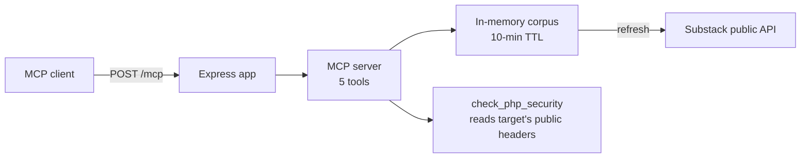

<div align="center">

# ⚡ Rimas Logic MCP Server

**Read [The AI Logic](https://rimaslogic.substack.com/) newsletter straight from your AI assistant.**

An open [Model Context Protocol](https://modelcontextprotocol.io) server — no signup, no API key.

[](https://github.com/rimaslogic/mcp-server/actions/workflows/ci.yml)
[](LICENSE)
[](package.json)
[](tsconfig.json)
[](https://modelcontextprotocol.io)

```
https://mcp.rimaslogic.pl/mcp
```

</div>

---

## 🚀 Quick start

**Claude Code**

```bash
claude mcp add --transport http rimas-logic https://mcp.rimaslogic.pl/mcp
```

**Claude.ai** — Settings → Connectors → *Add custom connector* → paste the URL above.

**Cursor / ChatGPT / any MCP client** — add a remote MCP server (streamable HTTP) with the URL above.

Then just ask: *"What has The AI Logic written about n8n?"*

## 🧰 Tools

| Tool | What it does |
|------|--------------|
| 📚 `list_articles` | All published articles, newest first — issue number, title, date, slug, URL |
| 📖 `get_article` | One article in full, as markdown — by slug or issue number (`"25"`) |
| 🔍 `search_articles` | Keyword search over titles, subtitles, and bodies, with excerpts |
| 💡 `about_the_ai_logic` | What the newsletter is, subscribe links, how to work with Rimas |
| 🛡️ `check_php_security` | Paste a URL → passive PHP risk report (php2shell RCE, end-of-life versions) + fix steps |

## 🛡️ Website PHP security check

`check_php_security` turns one question — *"is my site's PHP exposed?"* — into a plain-language
report. Paste a URL; the tool reads **only the public HTTP response headers the server already sends
to every browser** (`Server`, `X-Powered-By`, `Set-Cookie`), works out the PHP version if it is
disclosed, and compares it against a dated knowledge base:

- **php2shell** — the October 2026 unauthenticated RCE (CVE-2026-109618 / CVE-2026-109619, CVSS 9.2),
  fixed in **8.5.12 / 8.4.27 / 8.3.36 / 8.2.35**;
- **end-of-life branches** (8.1 is already unsupported; 8.2 goes EOL 2026-12-31);
- **CVE-2024-4577** (PHP-CGI argument injection) as a conditional note on Windows banners.

> **Ethics, by design.** It never probes paths, sends payloads, or attempts any exploit — it reads
> the same headers your browser receives. It refuses internal/private hosts (SSRF guard). A banner is
> an **indicator, not proof**: distributions backport fixes and versions can be hidden, so every
> verdict says "verify locally with `php -v`". Use it on sites you own or are authorised to check.
> Full research and sources: [`docs/php-security-research.md`](docs/php-security-research.md).

**Ask your assistant:** *"Check example.com for PHP vulnerabilities"* → you get a risk level, the
findings, numbered fix steps, and where to get help.

### 🔁 Keep checking — periodically, with Claude and/or Grok

New PHP CVEs land without warning (php2shell was an out-of-band release exploited *before* disclosure).
A one-off check ages fast, so wire up a recurring one. The server is just an open MCP endpoint, so any
agent can drive it.

**Claude (scheduled).** Add the connector, then schedule a recurring prompt:

- *Claude Code:* `claude mcp add --transport http rimas-logic https://mcp.rimaslogic.pl/mcp`, then
  use the `/schedule` skill (or a cron routine) with a prompt like
  *"Run check_php_security on https://mysite.com and https://shop.mysite.com. If any result is not
  INFO-level, summarise it and email/Slack me."* Weekly is a sensible default; daily while a critical
  CVE is active.
- *Claude.ai:* add the custom connector, then use Projects/Scheduled tasks with the same prompt.

**Grok (xAI).** Grok can call remote MCP tools too — add `https://mcp.rimaslogic.pl/mcp` as an MCP
server in a Grok client that supports them, then ask Grok to run `check_php_security` on your URLs on
a schedule (or paste the URL ad-hoc). Where MCP isn't available, Grok's live-search can still fetch
your site's headers and you can hand it the php2shell fix levels (8.5.12 / 8.4.27 / 8.3.36 / 8.2.35)
to judge against.

**Both, in combination (recommended for anything that matters).** Run the check on *two* independent
assistants and compare:

- **Cross-check / reduce false alarms** — a banner can be hidden on one path or spoofed; if Claude and
  Grok agree, you trust it more. If they disagree, that itself is the signal to look manually.
- **Divide the surface** — e.g. Claude watches production hosts on a daily cron, Grok does an
  ad-hoc/weekly sweep of staging and marketing subdomains.
- **Fresh second opinion** — ask one model to read the latest advisories (CISA/php.net) and the other
  to run the scan, then have them reconcile: *"is the fixed-version list still current?"*

The honest limit applies to every setup: this is a remote, header-based signal. For an authoritative
answer run `php -v` on the box (or `scripts/scan.mjs` from a machine you control), and when something
is red and you'd rather not deal with it, [book a call](https://cal.com/rimas-lukaszewicz/ai-consultation).

## ⚙️ How it works



One stateless Node/Express service. It pulls the publication's public Substack
API, converts every article to markdown once per refresh, and holds the whole
corpus in memory. If a refresh fails it serves the cached copy and says so in
the tool output. Each `POST /mcp` request gets a fresh MCP server instance over
the streamable HTTP transport.

| Endpoint | Purpose |
|----------|---------|
| `POST /mcp` | The MCP endpoint (stateless, streamable HTTP) |
| `GET /` | Human landing page with setup instructions |
| `GET /health` | Cache age, article count, staleness |

**Privacy & safety:** read-only, no data collected about callers, no secrets in
the service (env is just `PORT` and `SUBSTACK_URL`), rate limited to
60 req/min per IP. The newsletter tools fetch one hardcoded Substack host;
`check_php_security` fetches the single URL you pass it, reading response headers
only, and refuses internal/private hosts (SSRF guard). No payloads, no path
probing, nothing stored.

## 🛠️ Local development

```bash
npm install
npm test        # vitest — fixture-based, no network needed
npm run dev     # build + run on http://localhost:3000

npm run build && node scripts/scan.mjs https://your-site.com   # passive PHP scan from your machine
```

Deployed on [Railway](https://railway.com); `railway.json` holds the build and
start commands.

## 📬 About

Built by [Rimas Lukaszewicz](https://rimaslogic.pl) (Rimas Logic).
The AI Logic is a weekly newsletter about what actually works when you put AI
and automation into a business — real builds, real failures, and the logic
behind them.

- 📰 [Subscribe on Substack](https://rimaslogic.substack.com/)
- 💼 [Follow on LinkedIn](https://www.linkedin.com/build-relation/newsletter-follow?entityUrn=7478659510924959744)
- 🗓️ [Book an AI consultation](https://cal.com/rimas-lukaszewicz/ai-consultation)

## 📄 License

[MIT](LICENSE)
